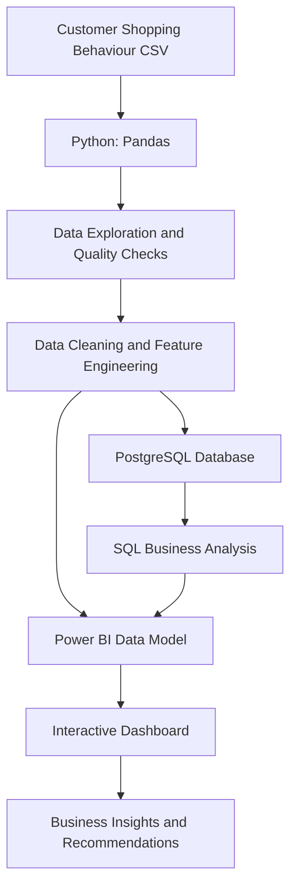

<div align="center">

# 🛍️ Customer Shopping Behaviour Analysis

### Turning customer purchase data into actionable business insights

**An end-to-end data analytics project using Python, PostgreSQL and Power BI**

[](https://www.python.org/)
[](https://www.postgresql.org/)
[](https://powerbi.microsoft.com/)
[](https://pandas.pydata.org/)

[Explore the Repository](https://github.com/mayankpandeymg9/Customer-Shopping-Behaviour-Dashboard) · [Report an Issue](https://github.com/mayankpandeymg9/Customer-Shopping-Behaviour-Dashboard/issues)

</div>

---

## 📌 Project Overview

Understanding customer behaviour is essential for improving sales, customer retention, product positioning and marketing effectiveness.

This project explores a customer shopping dataset and transforms raw purchase records into business-oriented insights. It follows an analytics workflow: **data exploration and preparation in Python, analytical querying in PostgreSQL, and interactive reporting in Power BI.**

The analysis focuses on customer demographics, product preferences, purchase patterns, discounts, subscriptions, shipping methods, reviews and revenue contribution.

## 🎯 Business Objectives

- Understand how purchasing behaviour differs across customer segments.
- Identify popular products and product categories.
- Examine the relationship between discounts, purchase amounts and customer activity.
- Compare purchasing patterns of subscribers and non-subscribers.
- Evaluate customer review ratings and shipping preferences.
- Present key metrics in a dashboard that supports business decision-making.

## 🧰 Technology Stack

| Tool | Purpose |
|---|---|
| **Python** | Data loading, exploration, preparation and feature engineering |
| **Pandas** | Data manipulation and analysis |
| **Jupyter Notebook** | Interactive analysis and documentation |
| **PostgreSQL** | Relational data storage and analytical SQL queries |
| **SQL** | Aggregations, filtering, CTEs, conditional logic and window functions |
| **Power BI** | Interactive dashboard and visual reporting |
| **CSV** | Source dataset format |

## 📊 Dataset at a Glance

The repository's CSV contains **3,900 records and 18 columns**.

The fields cover:

- **Customer profile:** Customer ID, age, gender and location.
- **Purchase details:** Item purchased, category, purchase amount, size, colour and season.
- **Experience:** Review rating and shipping type.
- **Promotions:** Discount applied and promo code used.
- **Customer relationship:** Subscription status, previous purchases and purchase frequency.
- **Payments:** Payment method.

> The notebook's initial data inspection reports 3,900 records. Review Rating has 3,863 non-null values, meaning 37 ratings are missing and should be considered during analysis.

## 🔍 Analysis Areas

### 1. Customer demographics
Explore age groups, gender distribution and customer locations to understand the composition of the customer base.

### 2. Product and category performance
Examine product popularity, category-level demand and average customer review ratings.

### 3. Revenue and purchase behaviour
Compare purchase amounts and revenue across customer groups, including gender and age segments.

### 4. Discounts and promotions
Identify products with high discount usage and customers who used discounts while spending at or above the overall average purchase amount.

### 5. Subscription analysis
Compare customer counts, average purchase amounts and total revenue between subscribers and non-subscribers.

### 6. Shipping and payment preferences
Explore shipping methods, average purchase amounts and payment-method preferences.

### 7. Customer segmentation
Use previous purchase counts to classify customers into New, Returning and Loyal groups. The SQL script defines these as:
- New: 1 previous purchase
- Returning: 2–10 previous purchases
- Loyal: more than 10 previous purchases

## 🧭 Project Workflow



## 📁 Repository Structure

```text
Customer-Shopping-Behaviour-Dashboard/
│
├── Business Problem Document.pdf
├── Customer_Shopping_Behaviour_Analysis.ipynb
├── Customer_behaviour_dashboard.pbix
├── customer_behaviour_queries.sql
├── customer_shopping_behavior.csv
├── README.md
└── PROJECT_REPORT.md
```

## 🚀 Getting Started

### Prerequisites

Install or have access to:

- Python 3.x
- Jupyter Notebook or JupyterLab
- PostgreSQL and a database client such as pgAdmin
- Microsoft Power BI Desktop

### 1. Clone the repository

```bash
git clone https://github.com/mayankpandeymg9/Customer-Shopping-Behaviour-Dashboard.git
cd Customer-Shopping-Behaviour-Dashboard
```

### 2. Set up Python

Create and activate a virtual environment (recommended):

```bash
python -m venv .venv
```

Windows:

```bash
.venv\Scripts\activate
```

macOS/Linux:

```bash
source .venv/bin/activate
```

Install the main analysis dependency:

```bash
pip install pandas jupyter
```

### 3. Run the analysis notebook

```bash
jupyter notebook Customer_Shopping_Behaviour_Analysis.ipynb
```

Keep `customer_shopping_behavior.csv` in the same working directory as the notebook, or update the CSV path in the notebook if you move the file.

### 4. Load the data into PostgreSQL

Create a database, for example:

```sql
CREATE DATABASE customer_shopping;
```

Create a table with columns compatible with the SQL script. The notebook's cleaned dataset uses the following analytical field names:

```sql
CREATE TABLE customer (
    customer_id INTEGER,
    age INTEGER,
    gender VARCHAR(20),
    item_purchased VARCHAR(100),
    category VARCHAR(50),
    purchase_amount NUMERIC(10,2),
    location VARCHAR(100),
    size VARCHAR(10),
    color VARCHAR(50),
    season VARCHAR(20),
    review_rating NUMERIC(3,1),
    subscription_status VARCHAR(10),
    shipping_type VARCHAR(50),
    discount_applied VARCHAR(10),
    promo_code_used VARCHAR(10),
    previous_purchases INTEGER,
    payment_method VARCHAR(50),
    frequency_of_purchases VARCHAR(50),
    age_group VARCHAR(30)
);
```

Import the prepared data into the `customer` table using pgAdmin's Import/Export tool or PostgreSQL `COPY`/`\copy`. Make sure the imported column names and data types match the SQL script. The original CSV uses title-case column names with spaces; the analytical table uses lowercase snake_case names.

### 5. Execute SQL analysis

Open `customer_behaviour_queries.sql` in pgAdmin or another PostgreSQL client, connect to the `customer_shopping` database and execute the queries.

### 6. Open the Power BI dashboard

Open `Customer_behaviour_dashboard.pbix` in Power BI Desktop. If prompted, configure the data source and refresh the model using the location and credentials for your local database or data file.

> **Note:** The exact Power BI connection configuration depends on how the PBIX file was authored. Update its data source settings rather than assuming a preconfigured local connection will work on every machine.

## 💡 Business Questions Answered

The SQL script contains queries designed to investigate questions such as:

1. How much revenue is generated by male and female customers?
2. Which customers used discounts but still spent at least the average purchase amount?
3. Which five products have the highest average review ratings?
4. How do average purchase amounts compare between Standard and Express shipping?
5. Do subscribers and non-subscribers differ in average spend and total revenue?
6. Which products have the highest percentage of discounted purchases?
7. How many customers fall into New, Returning and Loyal segments?
8. What are the most purchased products within each category?
9. How many repeat buyers are subscribers versus non-subscribers?
10. How is revenue distributed across age groups?

## 📈 Dashboard

The Power BI report is included in the repository:

[`Customer_behaviour_dashboard.pbix`](./Customer_behaviour_dashboard.pbix)

Open it with Power BI Desktop to explore the report. Add dashboard screenshots to this README when available so visitors can preview the visuals without opening the PBIX file.

Suggested screenshot location:

```text
assets/dashboard-overview.png
```

Then embed it here:

```markdown

```

## 🧠 Skills Demonstrated

- Exploratory Data Analysis (EDA)
- Data quality inspection and missing-value awareness
- Data cleaning and feature engineering
- Python and Pandas
- PostgreSQL and analytical SQL
- Aggregations, subqueries, CASE statements and CTEs
- Window functions and customer segmentation
- Business intelligence and dashboard development
- Translating business questions into measurable analysis

## 🔮 Future Improvements

- Add a reproducible data-cleaning script and a documented database import script.
- Validate missing values, duplicate records and category consistency systematically.
- Add SQL checks for nulls, duplicates and unexpected values.
- Include key performance indicators and clear metric definitions in the dashboard.
- Add interactive filters for age group, category, season, location and subscription status.
- Add a dedicated insights section with verified findings and business recommendations.
- Capture dashboard screenshots and add them to the repository.
- Add automated refresh and data-validation steps.

## ⚠️ Notes and Limitations

- This is an observational dataset; relationships found in the data should not automatically be interpreted as causal.
- The dataset includes 37 missing review ratings. Rating-based calculations should handle nulls appropriately.
- The source data contains purchase records and previous-purchase counts, but no explicit transaction date or order timestamp. Time-series and cohort-retention analysis would require additional data.
- SQL results and dashboard metrics should be validated against the same cleaned dataset and consistent business definitions.

## 👤 Author

**Mayank Pandey**

- GitHub: [@mayankpandeymg9](https://github.com/mayankpandeymg9)
- Project: [Customer Shopping Behaviour Dashboard](https://github.com/mayankpandeymg9/Customer-Shopping-Behaviour-Dashboard)

---

<div align="center">

**If you find this project useful, consider giving the repository a ⭐**

*Built to turn customer data into clearer business decisions.*

</div>
